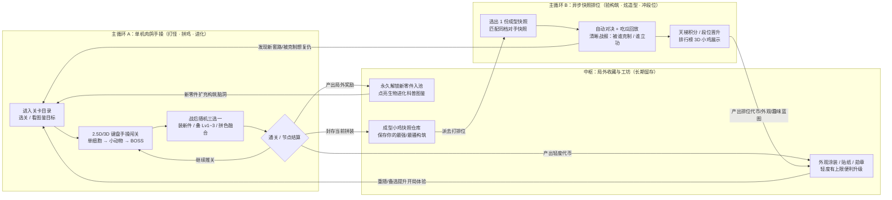

# 总闭环与双循环架构

版本：V1.3

日期：2026-11-26

状态：**本层已完整确认闭合**（覆盖 P-039~P-048）；全篇专有名词已与 `06` 统一（单一局外代币 = 「原初源质」，异步排位天梯 = 「万坤封神榜」，长线舞台 = 「巴别进化巨塔」）。其余系统细则归属 `07~10` 分别确认。

---

## 1. 文档边界与 MECE 职责

本文件是《拼装小鸡 / Build-a-Chick》**顶层游戏循环与资源流动**的唯一真理来源，归属 `05~10` 闭环文档组的第一篇：

- **本文负责**：单机肉鸽循环 × 异步排位循环如何咬合、局内/局外两层资源的产出（Source）与消耗（Sink）、“成型小鸡快照”跨模式流转边界、防通胀与防鬼服的总护栏。
- **本文不负责（交由专门文档定义，避免重复）**：
  - 具体剧情脚本、引导角色与生物科普图鉴文案 → 见规划文档 `06_世界观引导剧情与生物进化图鉴.md`；
  - 每一关的地图/波次/BOSS 机制与具体掉落表 → 见规划文档 `07_单机关卡体系与关卡奖励.md`；
  - 段位名称、积分算法、赛季重置与排位奖励明细 → 见规划文档 `08_对战排位体系与对战奖励.md`；
  - 战斗伤害公式、36 件零件点数预算与关卡成长曲线 → 见规划文档 `09_数值体系与经济平衡模型.md`；
  - 全系统边界/中断/异常覆盖与交互检查 → 见规划文档 `10_MECE需求覆盖与交互矩阵.md`。

---

## 2. 已确认的顶层设计底座

以下条目均为用户已确认决策，是本闭环不可动摇的前提：

1. **核心乐趣（P-001）**：外形创作与组合发现优先——让玩家拼出外观离谱但战斗逻辑自洽的“动物 + 机械混搭小鸡”。
2. **组装骨架（P-010~P-030）**：固定小鸡头锚点 + 6 部位；躯干支持最多 3 种不同零件拼色融合，其余 5 部位替换主轮廓；同件叠强最多 3 阶；微调（位移/旋转/缩放）仅影响外观；通用能力为主 + 8 组特殊组合/冲突。
3. **单机玩法形态（P-031~P-038）**：电脑端 HTML 键盘手操、四页面流程（主页面 → 装配车间 → 关卡目录 → 2.5D/3D 横版推进关卡）、聚焦键帽教学、实时终点小地图；敌人从单细胞生物/小动物递进到关底 BOSS，战后随机三选一拿零件/技能。
4. **对战排位形态（P-039，2026-11-26 确认）**：采用**异步“成型快照”排位（背包乱斗 / SAP 范式）**——单机手操闯关成型的小鸡封存为出战快照进入天梯，与其他玩家同档快照**自动对决**。
5. **局外关卡奖励定位（P-040，2026-11-26 确认）**：**解锁向为主 + 轻度有上限便利**（解锁新零件池、点亮生物科普图鉴、外观/涂装、轻度便利如重随/初始备选）；严禁无限局外数值养成。
6. **世界观与数值基调（P-041~P-042，2026-11-26 确认）**：轻松搞笑 + 真实生物冷知识 + 萌鸡反差中二味；紧凑清晰小数值（裸鸡基准 `HP=100, ATK=10`）+ 强机制克制（60% 组合克制 + 40% 数值与操作）。
7. **长线游戏定位（P-046，2026-11-26 确认）**：明确做**长线可扩展游戏**，首章 8 关只是“第 1 生态大章”，而非全游完结；架构上天然预留多章节生态地图、持续扩充的动物/机械/幻想零件池、无尽挑战与跨赛季排位更新。

---

## 3. 宏观双循环架构（PvE 肉鸽手操 × PvP 异步快照）

### 3.1 核心闭环图

### 3.2 为什么这套双循环能“自转”？（玩家动机链）

| 阶段 | 玩家心里想什么 | 对应系统承接 | 驱动的下一步 |
|---|---|---|---|
| **前 10 分钟（上手）** | “哈哈哈我给光鸡装了青蛙腿和鳄鱼嘴，还能跳起来躲变形虫！” | 聚焦键帽教学 + 第 1 关推图 + 三选一 | 打通第 1 关，解锁第 2 关和第一张生物科普卡 |
| **第 1~3 小时（上头）** | “还差 1 个机械件凑齐【全图制导锁定】，我想打赢第 4 关 BOSS 把它零件解锁进池！” | 关卡推进 + 局外零件扩池 + 图鉴收集 | 反复开肉鸽局，刷出越来越离谱的 3 阶成型鸡 |
| **第 3 小时后（炫耀与验证）** | “我刚拼出这只 3 阶喷气翼 + 刺猬反甲鸡太帅了，能不能去打爆别人的鸡？” | 通关封存快照 → 异步排位自动对决 + 战报复盘 | 看自己的鸡在天梯连胜、上榜展示 3D 外观 |
| **长期回流（博弈与复仇）** | “天梯全是【高空制空炮台】？我回单机专门刷一只【全图制导 + 特斯拉电尾】的反制快照来制裁他们！” | 排位环境反馈 → 回流单机定向刷快照 + 赛季新蓝图 | 形成 **PvE 产出构筑 → PvP 检验环境 → 回 PvE 针对性再构筑** 的永动飞轮 |

---

## 4. 两层资源流设计（局内 vs 局外严格分层）

为防止“单机肉鸽变无脑刷数值”或“排位变成老玩家面板碾压”，资源按生命周期严格拆分为两层：

### 4.1 局内资源（单局有效，结束清零，追求极高爽感）

| 资源/产物 | 来源（Source） | 去向（Sink） | 生命周期 | 状态 |
|---|---|---|---|---|
| **局内零件与叠阶（Lv1~3）** | 击败小怪波次/精英/BOSS 后的「随机三选一」 | 直接装到小鸡 6 槽位（替换、叠阶、躯干 3 拼色） | 本次闯关内有效；结算时可封存为快照 | 已确认（P-026, P-033, P-039） |
| **BOSS 标志技能/零件** | 击败关底 BOSS | 强化本局小鸡 + 首次击败同步解锁进局外掉落池 | 本局装备保留至通关；解锁资格永久 | 已确认（P-038, P-040） |
| **局内重随次数** | 局外轻度便利带入（每局硬上限 2 次） | 三选一界面刷新一次候选池 | 每局重置 | **已确认（P-045）** |
| **开局自选基础件** | 局外便利解锁后，开局自选 1 件基础零件带入 | 改善肉鸽起手手感，不改变中后期强度上限 | 每局开局生效 1 次 | **已确认（P-045）** |

### 4.2 局外资源（跨局永久保留，严控数值膨胀）

| 资源/产物 | 来源（Source） | 去向（Sink） | 防崩盘上限 | 状态 |
|---|---|---|---|---|
| **零件图鉴解锁资格** | 单机关卡首通 / 击败对应生态 BOSS / 排位趣味蓝图里程碑 | 永久加入后续肉鸽随机池 + 装配车间自由预览 | 扩宽构筑广度，不提高单件超模上限 | 已确认（P-040） |
| **生物与机械进化图鉴** | 遭遇/击败单细胞、小动物、机械怪与 BOSS | 点亮科普卡（真实生物冷知识）+ 累计里程碑领外观/代币 | 纯正向收集与知识成就 | 已确认（P-038, P-041） |
| **外观与排面资产** | 关卡星级/成就、排位段位、赛季结算 | 鸡身涂装、工坊贴纸、胜利动作、段位框、排行榜 3D 展台 | **零战斗属性加成** | 已确认（P-040） |
| **单一局外通用代币：「原初源质」**（简称：源质） | 单机关卡结算（首通多、重刷少）+ 「万坤封神榜」日常/段位里程碑 | 解锁涂装外观、购买三项局外轻度便利（重随上限 2 次、开局自选 1 基础件、快照槽 3→6）、兑换赛季趣味蓝图 | **仅设 1 种代币；三项便利设低硬上限；严禁无限攻防强化；不开放“四选一”** | **已确认（P-044, P-045, P-048）** |

---

## 5. 跨模式桥梁：“成型快照”流转与隔离护栏

这是双循环最容易出 bug 或失衡的接口，必须在架构层定死规则：

### 5.1 快照包含什么？（已对齐已有数据结构）
一份可上传/可离线镜像对战的「小鸡快照」应为**纯确定性 JSON**：
- 6 槽位装配清单（含零件 ID、同件阶数 `Lv1~3`、躯干 1~3 种融合顺序）；
- 造型微调参数（仅影响外观渲染，不参与战斗计算，承接 P-006 / P-028）；
- 激活的特殊组合 ID 列表（承接 P-030）；
- **快照分档标签（Tier / 关数印记）**：记录该快照是在第几关结算封存的（例如“第 3 关档 / 第 6 关档 / 完整通关档”），用于排位**同档匹配**；
- 玩家昵称、段位徽章与外观涂装 ID。

### 5.2 四条架构防线（防崩盘铁律）

1. **手操与自动解耦（职责隔离）**：
   - 单机关卡是**键盘手操**（躲弹幕、跳地形、抓攻击窗口），让玩家亲手“养大”这只鸡；
   - 排位对战是**快照自动对决**（由统一的确定性 AI/行为规则驱动跳跃、距离保持与技能释放），检验纯拼装与克制理解。
   - *已知风险*：某些零件在手操中很强，在自动对战中 AI 不会用怎么办？→ 解决原则：在 `08` 和 `09` 中为每类零件定义清晰的**自动行为优先级**（如空中件自动保持升空、近战件自动突进），且提供完整战报与回放。
2. **同档分池匹配（防降维打击）**：
   - 只打通第 3 关的新手快照，**绝不会**匹配到打通第 8 关全身满 3 阶的老玩家快照。同关档/同段位匹配，保证萌新第一天也能在初级场赢出成就感。
3. **无鬼服兜底（官方种子池）**：
   - 任何段位/关档内置一批官方设计的**风格化原型快照**（如“池塘弹簧蛙鸡”、“铁甲刺猬球”），新服或离线环境下也能秒匹有趣对手；随着真实玩家快照增多，逐步平滑替换为真实玩家镜像。
4. **排位奖励零数值碾压（防滚雪球）**：
   - 排位高段位奖励以**段位荣誉、3D 展台、限定涂装、通用代币加速、机制型趣味蓝图（同点数预算）**为主；绝不允许排位前 1% 独占高数值神装。

---

## 6. 本层细节确认记录与长线扩展接口

以下三项闭环细节已于 **2026-11-26** 全部由用户拍板确认，直接锁死并下发给 `07~09` 文档执行：

| 编号 | 决策项 | 已确认结论 | 对应 ID |
|---|---|---|---|
| **Q-05-1** | **快照封存时机与分池** | **每打通一关均可选择封存/更新对应“关档”快照**（按关档分池匹配，例如 1~3 关初级池、4~6 关进阶池、7~8 关巅峰池，后续新章拓展更高池或赛季池），保证新手前 10 分钟就能体验排位且绝不跨级挨打。 | **P-043** |
| **Q-05-2** | **局外通用货币数量** | **只设 1 种局外通用代币「原初源质」**，单机关卡与「万坤封神榜」共同产出，统一消耗在涂装外观、轻度便利与趣味蓝图上，降低认知负担。 | **P-044, P-048** |
| **Q-05-3** | **局外轻度便利清单** | 确认开放且**仅开放以下三项（均零攻防加成）**： ① **三选一重随次数**（每局硬上限 2 次）； ② **开局自选 1 件基础零件**； ③ **快照保存槽位扩容**（默认免费 3 个 → 最多 6 个）。 *明确否决“三选一变四选一”，保持三选一紧凑策略感。* | **P-045** |

### 长线扩展接口（按 P-046 预留）
- **横向扩展章节**：第 1 章（8 关）不是终点，而是长线内容的第一卷；每新增一个生态大章，同步新增该章怪物/BOSS、专属零件入池、对应图鉴分卷与新关档/赛季排位规则。
- **纵向重玩玩法**：通关首章后向长线过渡，在 `07` 与 `08` 中衔接 **无尽进化模式 / 每周变异词条 / 赛季天梯主题**，避免老玩家“8 关打完无事可做”。

---

## 修订记录

| 版本 | 实际修订日期 | 变更内容 |
|---|---|---|
| V1.1 | 2026-11-26 | 基于 P-039~P-042 建立总闭环与双循环架构首版：明确单机肉鸽手操 × 异步快照排位的咬合逻辑、局内/局外资源分层、跨模式四条防线，并列出 Q-05-1~Q-05-3 待用户确认项。 |
| V1.2 | 2026-11-26 | 回写 P-043~P-046：闭合 Q-05-1~Q-05-3（每关可封存关档快照、单一局外代币、三项零攻防便利且不做四选一），并明确长线多章节扩展定位。本层架构已完整定案。 |
| V1.3 | 2026-11-26 | 对齐 P-048 正式中二名词：局外通用货币定名为「原初源质」，异步快照排位天梯定名为「万坤封神榜」。 |
