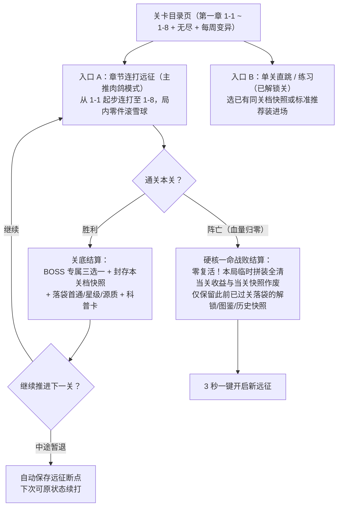

# 单机关卡体系与关卡奖励

版本：V1.1

日期：2026-11-26

状态：**本层核心结构、硬核一命肉鸽战败规则、三重奖励与双常青长线模式均已由用户确认（P-049~P-052）**；各关精确 HP/ATK 数值与「原初源质」产出数字统一归口 `09_数值体系与经济平衡模型.md` 定标。

---

## 1. 文档边界与 MECE 职责

本文件是《拼装小鸡 / Build-a-Chick》**单机关卡体验、推进模式、第一章 8 关完整配置、关卡奖励与单机长线常青玩法**的唯一真理来源：

- **本文负责**：双入口推进架构（章节连打远征 × 目录单关直跳）、单关 60~90 秒推进结构、硬核一命战败规则、第一章 8 关波次/BOSS 机制/36 件零件解锁映射、三重关卡奖励、以及通关首章后的「巴别无尽深渊」与「每周狂想变异赛」。
- **本文不负责（交由专门文档定义）**：
  - 剧情文案、中二名词与图鉴冷知识内容 → 见 [06_世界观引导剧情与生物进化图鉴.md](06_世界观引导剧情与生物进化图鉴.md)；
  - 「万坤封神榜」段位积分、快照匹配算法与排位奖励 → 见规划文档 `08_对战排位体系与对战奖励.md`；
  - 伤害公式、TTK 怪物血量表与「原初源质」具体价格表 → 见规划文档 `09_数值体系与经济平衡模型.md`。

---

## 2. 双入口推进架构（已确认，P-049）

为同时满足“**肉鸽连打越拼越爽**”与“**关卡目录 1~8 随时选关练手/刷图鉴**”（P-035），单机关卡提供双入口且规则严格隔离：

### 2.1 两种入口的产出边界（防漏洞防刷）
| 维度 | 入口 A：章节连打远征（主推） | 入口 B：单关直跳 / 练习 |
|---|---|---|
| **准入条件** | 随时可从本章第 1 关开启（或从断点续打） | 仅可选择已解锁的关卡 |
| **入场装备** | 裸鸡起步（解锁局外便利后可自选 1 件基础零件），跨关继承并不断叠阶/拼色 | 从玩家同关档已有快照中任选 1 只，或使用系统预设的该关档标准体验装 |
| **快照封存资格（进万坤榜）** | **完整允许**（每次通过新关可刷新对应关档快照） | **禁止直接刷更强快照进榜**（防跳过前关白嫖高阶档；仅用于练手、补三星与补图鉴） |
| **首通 / 星级 / 图鉴** | 全部正常结算 | 可正常补三星评价、补图鉴收录与赚取少量重刷源质 |

---

## 3. 单关 60~90 秒推进节奏与硬核一命规则（已确认，P-050, P-052）

### 3.1 单关标准三段推进（2.5D/3D 横版 + 实时终点小地图）
每一关为一条横向 3D 生态赛道（约 `36m ~ 54m`），右上角小地图实时标示：**玩家位置 / 小怪波次点 / 精英点 / 终点 BOSS 祭坛**。

1. **第 1 段（0~20 秒 · 热身波）**：遭遇单细胞生物或本生态基础小怪，清完原地弹出**「关内基因篡夺三选一 #1」**（立刻装上，外显与手感实时变化）。
2. **第 2 段（20~45 秒 · 生态精英波）**：遭遇本关特色动物/机械精英组合，演练克制关系（如防反伤、对空拦截），清完弹出**「关内基因篡夺三选一 #2」**。
3. **第 3 段（45~90 秒 · 关底 BOSS 战）**：抵达小地图终点祭坛，触发 BOSS 霸气出场 + 蛋壳 0 号 1 句提示；BOSS 拥有明确前摇与**地面/空中分层招式**（承接 P-008/P-009）。
4. **关底结算**：弹出**「BOSS 专属基因篡夺三选一」**（必含 1 件本关 BOSS 标志零件）→ 选择是否更新本关档「万坤封神榜」快照 → 展示星级/原初源质结算 + 本关新收录生物冷知识卡片。

### 3.2 硬核一命肉鸽战败规则（P-050）
- **零复活、零原地重试**：血量归零立即判定本局远征终结，体现纯正肉鸽的生死紧张感与构筑敬畏心。
- **战败清理口径**：
  - **立即清空**：本局远征临时拼装的所有零件、叠阶与特殊组合；**当前阵亡这一关**未结算的所有源质与本关快照全部作废（**不发战败安慰奖**）。
  - **永久保留（既定历史）**：在本局之前、以及本局中**已真正打通并完成结算的前序关卡**所落袋的关卡解锁进度、首通零件池解锁、已收录图鉴、历史源质与已封存进仓库的快照。
- **极速重开体验**：战败结算页明确给出**「一眼看懂为什么输」**（谁击杀了你、哪类攻击克制了你、蛋壳 0 号 1 句毒舌复盘），底部大按钮 **「3 秒重开新远征」** 直返起跑线。

---

## 4. 第一章《巴别第一层 · 原初破壳篇》8 关完整规格表

> 36 件现有动物+机械零件（见 [src/data/parts.ts](../../src/data/parts.ts)）全量映射如下，**零遗漏、零孤儿件**：
> - **初始基础随机池（6 件，开局即可抽到）**：`body.swift`（雨燕身）、`body.caterpillar`（毛毛虫节）、`beak.woodpecker`（啄木鸟钻喙）、`crest.rabbit`（兔子长耳朵）、`tail.gecko`（壁虎断尾）、`wings.mantis`（螳螂镰刀臂）。
> - 以下 8 关首通共永久解锁其余 **30 件**，全部打通第一章即集齐首发 36 件完整零件库！

| 关号 & 关名 | 长度 / 节奏定位 | 小怪波次（波 1 → 波 2） | 关底 BOSS & 核心机制（含高度判定） | 首通永久解锁入池（共 30 件） | 3 星评价口径（1★固定为通关） |
|---|---|---|---|---|---|
| **1-1 原初沸腾浅滩** | `36m` · 聚焦键帽教学关 | 变形虫/草履虫 → 小刺猬 + 小青蛙 | **弹跳暴君 · 巨蛙王**：蓄力高跳下砸（地面震波，玩家跳起可躲）+ 舌击前扑 | **`legs.frog`（青蛙弹跳腿 · BOSS标志）**、`body.hedgehog`（刺猬身）、`tail.peacock`（孔雀开屏尾） | 2★ 血量≥50%；3★ 完成全部 5 步教学且 90s 内通关 |
| **1-2 铁甲棘刺丘陵** | `40m` · 防御与反伤教学 | 滚壳蜗牛/变形虫 → 卷球刺猬群 + 重壳陆龟 | **不动要塞 · 铁背巨龟王**：缩壳减伤反伤 + 滚动碾压（地面重击，迫使玩家拉扯或破甲） | **`body.turtle`（乌龟壳 · BOSS标志）**、`tail.ankylo`（甲龙骨锤尾）、`crest.deer`（雄鹿分叉角） | 2★ 血量≥50%；3★ 85s 内击败 BOSS |
| **1-3 噬骨泥泞河湾** | `42m` · 爆发与击退教学 | 膨胀小河豚/草履虫 → 横行钳蟹 + 潜伏鳄苗 | **断颌霸主 · 沼泽巨鳄王**：死亡翻滚突袭（高额近战地面爆发）+ 甩尾扫飞 | **`beak.croc`（鳄鱼大嘴 · BOSS标志）**、`body.puffer`（河豚身）、`wings.crab`（螃蟹大钳）、`legs.octopus`（章鱼触手腿） | 2★ 血量≥50%；3★ 躲避至少 2 次巨鳄重咬且通关 |
| **1-4 裂风穹顶林冠** | `44m` · 立体空战转折关 | 疾风蜻蜓（空中）→ 夜袭蝙蝠群 + 幼鹰斥候 | **苍穹裁决者 · 疾风鹰王**：高空盘旋（仅对空攻击可命中）+ 俯冲利爪抓击（落地硬直是输出窗口） | **`legs.eagle`（老鹰利爪腿 · BOSS标志）**、`wings.dragonfly`（蜻蜓双翼）、`wings.bat`（蝙蝠膜翼） | 2★ 血量≥50%；3★ 空中/对空命中 BOSS ≥5 次通关 |
| **1-5 幽冥荧光毒沼** | `46m` · 异常状态与反制 | 潜伏变色龙（远程对空舌）→ 断尾壁虎 + 毒针小蝎 | **剧毒冥王 · 幽光巨蝎**：尾刺持续施毒（无视部分护甲）+ 闪光致盲干扰 | **`tail.scorpion`（蝎子毒尾 · BOSS标志）**、`beak.chameleon`（变色龙长舌）、`crest.angler`（灯笼鱼钓竿） | 2★ 血量≥50%；3★ 触发至少 1 组特殊组合通关 |
| **1-6 震地狂奔原野** | `48m` · 重装冲击与机动 | 疾驰鸵鸟（极速切入）→ 重踏小象（抗击退）+ 冲锋野鹿 | **破城重坦 · 裂地犀牛王**：铁头长距离冲锋（高额击退，靠跳跃越过或重盾架挡）+ 震地践踏 | **`crest.rhino`（犀牛独角 · BOSS标志）**、`legs.ostrich`（鸵鸟疾跑腿）、`legs.elephant`（大象稳重腿）、`beak.elephant`（大象长鼻） | 2★ 血量≥50%；3★ 95s 内击败 BOSS |
| **1-7 失控钢铁墓场** | `50m` · 机械飞升大转折 | 暴走弹簧球（高频弹跳）→ 电锯滚轮机 + 铁盾守卫 | **高压疯魔 · 特斯拉机甲鸡**：全屏可对空高压电弧 + 喷气冲刺连斩（考验走位与爆发） | **`tail.tesla`（特斯拉电尾 · BOSS标志）**、`legs.spring`（机械弹簧腿）、`body.iron`（铁皮装甲身）、`wings.shield`（铁门重盾翼）、`beak.chainsaw`（机械电锯嘴）、`tail.propeller`（机械螺旋桨尾） | 2★ 血量≥50%；3★ 身上至少装备 2 件机械件通关 |
| **1-8 第一界域天顶** | `54m` · 第一章守门终战 | 生物+机械混装禁卫小队 → 精英双人组（空+地配合） | **第一界域代行者 · 苍穹铁羽暴君鸡**：两阶段变身（一阶段喷气制空炮击，二阶段过载俯冲重击），检阅玩家构筑与手操综合力 | **`wings.jetpack`（喷气推进翼 · BOSS标志）**、`beak.cannon`（迷你炮口）、`crest.radar`（迷你雷达锅）、`crest.crown`（黄金王冠） | 2★ 血量≥50%；3★ 携带至少 1 件 Lv3 满阶件或特殊组合通关 |

---

## 5. 三重关卡奖励体系（已确认，P-040, P-051）

严守 **P-040 零无限攻防铁律**，关卡奖励按 MECE 拆成互不重叠的三重激励：

| 奖励层级 | 触发条件 | 奖励内容 | 长期价值与设计目的 |
|---|---|---|---|
| **第一重：首通重奖** | 首次击败某关 BOSS | ① 永久解锁该关对应 3~6 件零件入随机池； ② 解锁下一关与对应「万坤封神榜」关档池； ③ 一次性大额「原初源质」。 | 驱动玩家一口气推通全部 8 关，每过一关都有新玩具进池。 |
| **第二重：三星评价 & 章节星箱** | 每关 1★/2★/3★；本章满 `8★ / 16★ / 24★` 开宝箱 | 8★：原初源质 + 专属贴纸； 16★：原初源质 + 蛋壳 0 号限定护目镜外观； 24★（满星）：大额原初源质 + 第一章限定涂装**「巴别破壳金羽」**与荣誉勋章。 | 给喜欢挑战操作的玩家提供重玩与精细化打法目标，零数值破坏。 |
| **第三重：重复刷关收益** | 重复通关已通关卡 | ① 少量「原初源质」（按关档小幅递增，设合理产出防爆肝）； ② **核心驱动**：打出一把更胡的 3 阶/彩蛋组合，刷新「万坤封神榜」冲榜快照； ③ 补全图鉴未遭遇物种与收集度里程碑。 | 让单机关卡和排位天梯永远互相输血，不会首通一次就变死地图。 |

*(注：具体每关首通/重刷产出多少「原初源质」、三项局外轻度便利（P-045）各自定价多少，统一放在 `09_数值体系与经济平衡模型.md` 计算配平。)*

---

## 6. 通关首章后的长线常青单机体系（已确认，P-046, P-052）

打通 `1-8` 只是踏出巴别进化巨塔第一层！玩家立即解锁两大单机常青模式，平稳衔接第二章（深渊暗海界）等长线大版本更新：

### 6.1 「巴别无尽深渊（Endless）」
- **解锁条件**：首通 `1-8 第一界域天顶`。
- **核心规则**：
  - 全已解锁零件池开放，同样遵守**硬核一命无复活**；
  - 每一层随机抽取已解锁章节的生态场景与敌群，**每 5 层**遭遇一位强化版界域 BOSS（掉落 1 件直接升阶的满能篡夺三选一）；
  - **动态变异词条（从第 6 层起每 3 层叠加 1 条）**：例如「低重力浮空（全员跳高+40%）」「剧毒迷雾（双方每 5 秒受毒）」「暴走加速（全员攻速+25%）」——迫使玩家根据词条临场调整拼装，绝不能一套公式无脑挂机；
  - **产出与排行**：按最终抵达层数结算「原初源质」+ 记入**全服《巴别无尽深度榜》**（展示你倒下前那只最离谱小鸡的 3D 造型与层数！）。

### 6.2 「每周狂想变异赛」
- **解锁条件**：首通 `1-4` 或 `1-8` 后开放（每周一刷新固定规则与随机种子）。
- **核心规则**：
  - 每周限定一套极度欢乐的**全局变异法则**（如「纯机械飞升周：随机池只出机械件」「全员弹力球周：击退距离 ×3」「3 拼色狂欢周：躯干掉落率翻倍」）；
  - 玩家在相同固定种子下挑战 5 关迷你冲刺赛，比拼通关耗时与剩余血量；
  - **奖励**：每周参与即得「原初源质」低保，达成目标分数领限定周赛徽章与趣味涂装。

### 6.3 长线新章节接入模板（给后续第 2~N 章直接复用）
未来每扩展 1 个新大章（如第二章《深渊暗海篇》），按标准数据包接入即可，**零重构成本**：
1. 新增 `8` 关生态场景配置 + 对应小怪/BOSS（含高度判定标签）；
2. 新增 `12~18` 件新主题零件（沿用现有 6 槽位 + 1~3 阶 + 躯干 3 拼色框架）及 `3~5` 组新特殊组合；
3. 新增该章《万象进化秘典》分卷与 24 星宝箱限定涂装；
4. 在「万坤封神榜」开放新赛季主题与对应高阶关档池。

---

## 7. 确认状态与下游衔接

- **本层已确认闭合**：P-049（双入口推进）、P-050（硬核一命零复活战败规则）、P-051（三重关卡奖励）、P-052（60~90 秒推进结构 + 无尽深渊 + 每周狂想变异赛）。
- **微小口径备注**：P-050 目前按“零复活、本局临时构筑全清、当关阵亡颗粒无收，仅保留此前已真正通关落袋的历史解锁/图鉴/源质”落盘；若后续试玩觉得需更硬核（例如连前几关没带出远征的源质也一并清空），可随时收紧。
- **下一篇文档**：`08_对战排位体系与对战奖励.md`（围绕 **「万坤封神榜」** 展开异步自动对决、AI 驱动规则、关档分池、段位体系、赛季节奏与排位奖励细则）。

---

## 修订记录

| 版本 | 实际修订日期 | 变更内容 |
|---|---|---|
| V1.1 | 2026-11-26 | 基于 P-049~P-052 完成单机关卡体系与奖励首版：定义双入口推进架构、60~90 秒单关结构、硬核一命零复活战败规则、第一章 8 关与 36 件实际零件全量解锁映射、三重关卡奖励、巴别无尽深渊、每周狂想变异赛与长线新章接入模板。 |
