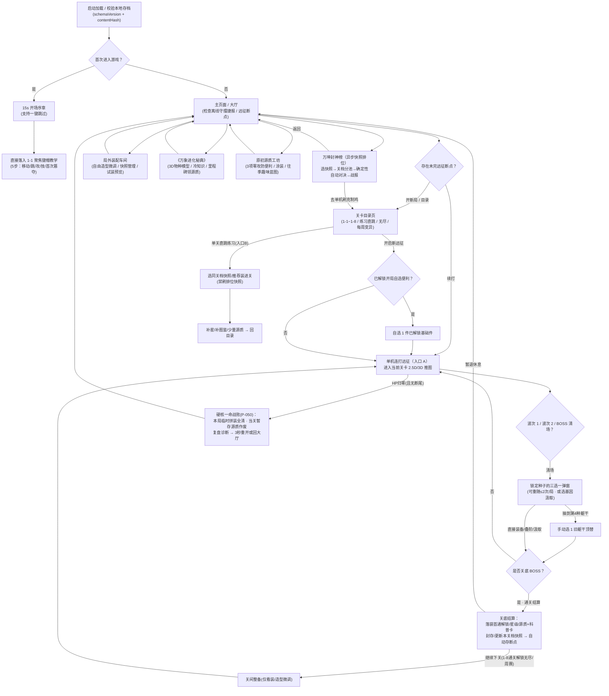

# MECE 需求覆盖与交互矩阵

版本：V1.1

日期：2026-11-28

状态：**全主流程闭环验收文档已闭合落盘（覆盖 P-001~P-004、P-006~P-066）**。本文标志 `05~10` 全套主流程玩法 GDD 完成 MECE 穷尽收口；后续工程接口对齐（`docs/INTERFACES.md`）、代码重构与 UI 视觉设计均以本套已闭合文档为唯一基线。

---

## 1. MECE 分解框架与唯一职责归属

按 [02_玩法设计工作规范.md](02_玩法设计工作规范.md) 第 6 节要求，将《拼装小鸡 / Build-a-Chick》全主流程拆解为 **7 个相互独立、完全穷尽（MECE）的系统主责域**。每条需求仅归属 1 个主责域，其他域通过稳定 ID 引用，严禁两份有效规则并存：

| 域编号 | 主责域名称 | 需求 ID 前缀 | 唯一真理来源文档 | 本域不负责（防止越界） |
|---|---|---|---|---|
| **D1** | 对局流程与生命周期 | `FLOW-*` | [05_总闭环与双循环架构.md](05_总闭环与双循环架构.md) + 本文 P-062 | 不定义具体怪物血量或伤害公式 |
| **D2** | 组装、融合与构筑 | `ASM-*` | [04_装配体验与组合设计_讨论稿.md](04_装配体验与组合设计_讨论稿.md) + [09](09_数值体系与经济平衡模型.md) + 本文 P-063 | 不定义具体 3D 渲染实现与 UI 布局 |
| **D3** | 战斗内核与机制结算 | `CBT-*` | [09_数值体系与经济平衡模型.md](09_数值体系与经济平衡模型.md) + 本文 P-064 | 不定义排位积分或关卡掉落 |
| **D4** | 单机关卡与常青挑战 | `STG-*` | [07_单机关卡体系与关卡奖励.md](07_单机关卡体系与关卡奖励.md) + [06](06_世界观引导剧情与生物进化图鉴.md) | 不定义局外货币定价与排位匹配 |
| **D5** | 异步快照与万坤封神榜 | `PVP-*` | [08_对战排位体系与对战奖励.md](08_对战排位体系与对战奖励.md) + 本文 P-065 | 不定义单机手操按键与推图节奏 |
| **D6** | 局外经济、图鉴与外观 | `ECO-*` | [05](05_总闭环与双循环架构.md) + [06](06_世界观引导剧情与生物进化图鉴.md) + [09](09_数值体系与经济平衡模型.md) | 不赋予外观任何战斗数值 |
| **D7** | 持久化、版本与异常降级 | `SYS-*` | 本文 P-062、P-065、P-066（后续映射至 `docs/INTERFACES.md`） | 不替玩法改数值或体验规则 |

> **范围外明确留白（不提前建设）**：实时同步联机 PvP（旧 M3 远期规划）、玩家跨服造型交易/社区广场（P-029 远期规划）、内购支付与商业化变现、以及移动端/小游戏端适配（P-032 首轮聚焦电脑端 HTML）。

---

## 2. 端到端全主流程闭环状态机（零死胡同验证）

**流程闭环自检**：
- 任意页面均有明确返回入口，无死胡同；
- 首次进入 15 秒序章可跳过，1-1 教学可跳过且通关/完成后后续新远征默认静默跳过；
- 战败后 1 次点击 3 秒重开，排位输后 1 次点击直跳单机刷克制构筑，核心双循环零断点。

---

## 3. MECE 覆盖矩阵：`7 大系统域 × 5 种运行态`（35 格全闭合）

| 系统域 | 正常态（Normal） | 失败态（Failure） | 边界态（Boundary） | 中断态（Interrupt） | 恢复态（Recovery） |
|---|---|---|---|---|---|
| **D1 对局流程** (`FLOW`) | 序章 → 教学 → 远征推关 → 结算 → 进下关或返大厅 | 硬核一命阵亡：清本局临时拼装与当关未结算收益，弹出死因复盘 | ① 1-1 教学期阵亡：原地复活满血重练当前教学步（教学特例不惩戒）； ② 1-8 通关后自动触发章末 30s 暗线对话并解锁无尽/周赛 | 远征战斗中途意外刷新/断电/关页；或三选一弹窗时关页 | ① 关间结算自动保存永久断点； ② 战中意外退出整局限 **1 次**免费重开当前关，超 1 次视同主动放弃/阵亡（P-062）； ③ 三选一按确定性种子还原原 3 卡防 SL |
| **D2 组装构筑** (`ASM`) | 6 槽装配、同件 1→2→3 阶升阶、躯干 1~3 种拼色融合、精简版造型微调、撤销与方案保存 | ① 非躯干同件已满 Lv.3 拒绝继续叠加（`max_level`）； ② 零件槽位不匹配拒绝装配 | ① 躯干满 3 种抽到第 4 种：弹出**手动选 1 旧躯干顶替**（P-063）； ② 候选池几乎全满阶导致可用新件 `<3`：空位自动补为强化版基因汲取项； ③ 生物翼+重型件触发 `grounded` 冲突并标红提示 | 拖动零件半途松手 / 按 ESC / 切出页面；或微调滑块未保存直接切页 | 拖拽中断无损回弹；局外车间支持 25 步撤销（含微调记录）；清空某槽自动复位该槽微调参数 |
| **D3 战斗内核** (`CBT`) | 确定性 8 步伤害管线、3D 高度对空判定、`K` 爆发融合 / `S` 防御举盾、被动与彩蛋触发 | 攻击落空（空中躲避 / 闪避 / 超射程），给出明确飘字反馈 | ① **同 tick 同归于尽**：PvE 算玩家险胜留 `1 HP`，PvP 算平局不扣分（P-064）； ② 闪避硬顶 `35%`，护甲永不归零（保底 `1` 伤）； ③ 反伤不二次触发反伤（防死循环）； ④ 空中怪必带落地硬直防无对空软锁（P-064） | 单机战斗按 `Esc` / 浏览器切后台失焦 | 浏览器失焦自动暂停单机计时与按键输入（防切窗白挨打），切回点击继续；所有按键状态 `blur` 时自动清空防卡键 |
| **D4 单机关卡** (`STG`) | 入口 A 章节连打远征（1-1~1-8，60~90s/关）；入口 B 已解锁关直跳练习；无尽深渊与每周变异赛 | 入口 A 阵亡清临时构筑；入口 B 阵亡仅重来当前练习关，不损任何局外资产 | ① 1-1~1-8 中未击败 BOSS 前终点拱门锁定不可偷跑； ② 每周变异赛跨周一 00:00 刷新时，正在进行的旧周赛局允许打完结算旧榜，新开局切新种子； ③ 无尽深渊词条叠加上限 5 条，之后轮换增强 | 关间点击「暂退」挂起远征，玩家先去打几把排位或看图鉴 | 远征断点与排位/练习模式状态严格隔离，随时回到目录点「继续远征」原血量原拼装续打 |
| **D5 万坤封神榜** (`PVP`) | 选快照 → 同关档分池 + 同段位分秒匹 → 15~30s 确定性自动对决（支持 1x/2x/跳过）→ 复盘战报 | 对决战败按段位阶梯扣分（第 1 段 0 扣分，晋级后前 2 场降段保护）；提供一键跳转单机刷克制装 | ① **25s 过载狂暴 + 45s 硬终结**防双铁龟永动平局； ② 快照仓库满（3/3 或 6/6）封存新鸡：选旧槽覆盖，旧鸡自动转存只读**「历代封神相册」**（P-065）； ③ 低关档池在高段位触发胜分衰减，防初级池刷榜； ④ 4 周赛季结算段位软重置 + 现役快照全体归档相册 | ① 开战回放看到要输强关网页； ② 断网或早期纯前端无后端服务 | ① 点击「开战」瞬间确定性结果已锁定，强退照常结算积分防逃跑（P-065）； ② 无网自动降级为**本地离线镜像模式**（匹官方种子池、可练手与领日常低保，联网后不污染真实天梯分） |
| **D6 经济与图鉴** (`ECO`) | 单一代币「原初源质」产出与消耗；战中右上角轻量收录角标、战后科普卡、独立秘典页 | 原初源质不足时置灰购买并明示差额与最快获取途径（如首通/星箱/排位日常） | ① 局外三项便利达硬上限（重随 2 / 自选 1 / 快照槽 6）后自动标「已满级」绝不重复扣币； ② 离线守擂小费每日上限 5 场（+40 源质/日）封顶； ③ 赛季趣味蓝图季末自动下放源质商店，零绝版 | 领取里程碑/购买涂装瞬间断网或刷新 | 所有源质变动采用幂等流水（先落本地事务再同步），禁止同一首通/星箱/里程碑重复领取 |
| **D7 持久化与版本** (`SYS`) | 本地优先存档（`localStorage` / IndexedDB）+ 联网增量同步；存档带 `schemaVersion + contentHash` | 本地存储损坏、配额满或 JSON 解析失败 | ① 仅改数值平衡：无损保留远征断点与现役快照，按新配置实时重算面板（P-066）； ② 破坏性大改（删件/重构机制）：安全终止旧远征（保留永久解锁与源质 + **补偿 50 原初源质**），旧快照转入只读相册不删档（P-066） | 存储写入中断或跨端时间漂移 | 写入采用双副本（`save_primary` + `save_backup`）防写坏；损坏时自动回滚至备份并弹窗告知；支持手动导出/导入 JSON 存档字符串 |

---

## 4. 跨系统高危交互与冲突裁决矩阵（16 项硬规则）

下表逐条裁决最容易在多系统叠加时产生歧义或漏洞的交互场景，开发与测试必须 100% 遵守：

| 编号 | 交互场景 | 潜在冲突 / 漏洞 | 唯一裁决规则 | 关联决策 |
|---|---|---|---|---|
| **INT-01** | 躯干已融合 3 种拼色 + 三选一抽到第 4 种新躯干 | 锁死不能选导致卡体验 vs 静默顶替导致误毁彩蛋 | 允许点选第 4 种躯干，随后弹出 3 个现有躯干的确认条由玩家**手动选 1 个顶替**（被顶替躯干原有阶数不转移给新躯干，新躯干从 Lv.1 起步）；玩家也可取消改选其他卡或基因汲取 | P-026, P-063 |
| **INT-02** | 生物翼（蜻蜓/蝙蝠）+ 重型件（乌龟/铁皮/大象/重盾）vs 再装喷气推进翼 | 物理冲突 `grounded` 与 `canGlide` 同时存在导致提示自相矛盾 | 严格以最终生效状态为准：生物翼+重型件强制 `grounded=true, canGlide=false`（只显示红色冲突提示，不显示滑翔生效）；换装 `wings.jetpack` 立即解除 `grounded`，允许负重强行浮空 | P-030, `09` §2.2 |
| **INT-03** | 同时装备多个主动特技件（如 `jetpack + rhino + shield + deer`） | 单键 `if/else if` 互相吞技能 | 严格按职能分键：`K` 键统一发进攻/机动爆发（`jetpack + rhino` 自动融合触发【火箭头槌】）；`S / ↓` 专用举盾/架挡（`shield + deer` 叠效 `-70%` 减伤 + 抗击退），零吞技能 | P-060 |
| **INT-04** | 同 tick 结算：双方互打 + 刺猬反伤 + 壁虎断尾 + 同归于尽 | 谁先死、反伤会不会套娃递归、断尾何时救命 | 严格按 `09` §3.1 8 步管线同 tick 原子结算：① 先扣双方本次攻击伤害；② 再结近战反伤（反伤标记 `nonReflectable=true`，绝不二次触发对方反伤）；③ 检查壁虎断尾保命（立即回至 `30% MaxHP` 并置已用）；④ 最后判胜负：若双方仍同时 `≤0`，PvE 判玩家险胜留 `1 HP`，PvP 判平局不扣分 | P-059, P-064 |
| **INT-05** | 1-4 空中 BOSS（疾风鹰王）+ 玩家 0 件对空零件 | 空中怪永远高空盘旋导致地面近战软锁卡死 | 所有空中怪/BOSS AI 强制包含**“俯冲攻击 → 落地硬直 1.6s”**周期窗口；纯地面构筑靠走位躲俯冲 + 抓硬直可稳妥通关（只是耗时更长、难度更高），绝不硬锁 | P-009, P-064 |
| **INT-06** | 三选一选「提纯原初源质 +15」后，在同关后续波次阵亡 | 玩家故意打完第 1 波选 +15 源质然后自杀反复刷币 | 关内提纯的源质进入**「本关暂存袋」**，必须击败本关 BOSS 完成过关结算才并入永久钱包；当关阵亡则暂存袋清零作废 | P-050, P-058 |
| **INT-07** | 入口 B（单关直跳练习）打通 1-8 | 跳过前 7 关直接用预设装刷出 1-8 巅峰快照去打排位 | 入口 B 强制标记 `canMintSnapshot = false`：可补星、补图鉴、拿少量重刷源质，但**绝不弹出封存排位快照入口** | P-049 |
| **INT-08** | 远征打通 1-3 后关间整备 vs 局外「装配车间」 | 玩家把局外已解锁零件直接塞进肉鸽远征作弊 | 远征态下「关间整备」**只读零件池**，仅开放查看属性/组合、部位造型微调（P-028 零战斗影响）与封存快照；局外「装配车间」独立于远征存档，仅作自由试装与管理快照 | P-063 |
| **INT-09** | 玩家连续重随三选一（≤2 次/局）或刷新页面重试三选一 | 利用 F5 刷新白嫖无限重随刷出胡牌 | 每关每个三选一节点的候选序列与最多 2 次重随序列，由 `hash(runSeed, stageId, nodeIndex, rerollCount)` 预先确定性锁定并写入断点；刷新重进呈现完全相同的 3 张卡与剩余重随次数 | P-045, P-062 |
| **INT-10** | 1-1 聚焦键帽教学期间玩家意外死掉 / 第二次开新远征 | 萌新在教学关被硬核一命劝退；老手每次重开都要看教学 | 教学状态标志 `tutorialCompleted` 永久存盘：① 首次教学未完成前在 1-1 阵亡触发蛋壳 0 号搞笑急救回满血重练当前步（教学保护）；② 完成后所有后续新远征默认静默跳过聚焦教学（大厅设置可随时重温） | P-036, P-050 |
| **INT-11** | 万坤封神榜：两只满配「反甲铁龟 + 毛毛虫回血 + 铁门举盾」互打 | 45 秒互刮不掉血导致无限平局 | 第 25s 启动「巴别过载狂暴」：每秒全局增伤 `+15%`、回血与护盾效能 `-50%`；若至 45s 仍双活，先比剩余血量百分比，再比总有效输出，仅完全相等才判平局 | P-053, `08` §4.2 |
| **INT-12** | 排位匹配时：高段位玩家（如暴走机甲坤）故意拿 1-2 初级池快照虐菜刷分 | 用初级池低门槛快照刷上全服前 100 | 按 `09` §6.1 分池衰减铁律：铁羽段起初级池胜分减半，奇美拉段起初级池 `0` 胜分；界域霸主与巅峰榜仅限巅峰池快照获取积分 | P-043, `09` §6.1 |
| **INT-13** | 排位连胜加分 × 新晋降段保护 × 战败扣分同时作用 | 降段保护期输球是否断连胜？ | 降段保护仅保护“段位分不跌破当前大段门槛”，**连胜计数在战败时照常清零**；降段保护次数按晋级事件刷新（每次晋升新大段给 2 场保护） | P-054, `09` §6.1 |
| **INT-14** | 造型微调（位置 X/Y/Z、旋转、缩放）× 战斗受击/跳跃高度判定 | 把鸡身往上拉 `0.4m` 试图白嫖“常驻空中态”躲地面攻击 | 逻辑内核 `CreatureStats` 与战斗碰撞盒**彻底忽略 `creature.tweaks`**；高度 `y` 仅由物理引擎跳跃/滑翔轨迹驱动，微调仅作用于渲染挂点 | P-006, P-028 |
| **INT-15** | 无尽深渊跨层推进 × 壁虎断尾 / 临时护盾 / 词条叠加 | 断尾保命整局只生效 1 次还是每层重置？临时护盾跨不跨层？ | 与单机关卡完全对齐：**每进入新一关/新一层**重置「壁虎断尾（1 次/层）」并清空上一层的「基因汲取临时护盾」；动态变异词条最多同时激活 5 条，后续新词条按队列轮换 | P-052, P-058 |
| **INT-16** | 4 周赛季切换瞬间玩家正在结算新快照，或仓库已满 6/6 | 新旧赛季快照混池 / 覆盖导致老造型丢失 | 每份快照带 `seasonId` 字段；新赛季生效后，旧 `seasonId` 快照一键转入只读「历代封神相册」释放全部 3~6 个现役排位槽；平时满槽覆盖旧槽时同样将旧快照自动转存相册（相册上限 30 份，可手动星标锁保护） | P-056, P-065 |

---

## 5. 全系统 MECE 需求总台账（开发与验收核对单）

> **诚实记账声明**：下表严格区分「策划闭合状态」与「代码实现状态」。当前仓库代码停留在 2026-11-25 的第 1 关 Demo 切片（`85161f4`），`05~10` 新定案的完整双循环、HP=100 数值迁移、8 关与排位系统均处于**“文档已闭合，代码待实施”**状态。

| 需求 ID | 主责域 | 核心规则摘要 | 确认决策 ID | 策划状态 | 当前代码现状 |
|---|---|---|---|---|---|
| `FLOW-01` | D1 | 四页面主流程 + 15s 序章（可跳过）+ 1-1 聚焦 5 步键帽教学 | P-035~P-036, P-047 | 已闭合 | 已做四页面与 4 步教学初版，缺序章与蛋壳 0 号文案 |
| `FLOW-02` | D1 | 关间自动存断点 + 战中意外退出限 1 次恢复 + 三选一锁种子防 SL | P-049, P-062 | 已闭合 | 待实施 |
| `ASM-01` | D2 | 固定鸡头锚点 + 6 部位 36 件动物/机械混搭 + 躯干 3 拼色 + 同件 3 阶 | P-010~P-027 | 已闭合 | 已在 Demo 落地初版，待按 `09` 迁新数值与拼色折算 |
| `ASM-02` | D2 | 精简版造型微调（零战斗影响）+ 撤销 + 方案保存 + 躯干满 3 顶替 + 远征关间隔离 | P-028~P-029, P-063 | 已闭合 | 已有微调/撤销/3 方案初版，缺顶替弹窗与远征隔离 |
| `ASM-03` | D2 | 8 组精确归属特殊组合与物理冲突 + 单关 3 次三选一配「基因汲取」转化 | P-030, P-033, P-058 | 已闭合 | 已有 8 组组合与三选一初版，缺基因汲取与重随 |
| `CBT-01` | D3 | 统一确定性战斗内核（支持手操与自动 AI 双驱动）+ 8 步伤害管线 + 边际递减护甲 | P-042, P-059 | 已闭合 | **架构待重构**：当前手操战斗耦合在 `src/ui/stage-battle.ts` |
| `CBT-02` | D3 | 3D 高度对空判定 + 多主动技分键融合（K 爆发 / S 防御）+ 同归于尽与空中硬直防软锁 | P-008~P-009, P-060, P-064 | 已闭合 | 已有基础跳跃对空，缺 S 键防御、K 融合与防软锁约束 |
| `STG-01` | D4 | 双入口推进（连打远征 × 直跳练习）+ 硬核一命零复活战败规则 | P-049~P-050 | 已闭合 | 待实施（Demo 目前仍为 6 关目录且战败保留零件） |
| `STG-02` | D4 | 第一章 8 关 36 件全量解锁映射 + 三重关卡奖励（首通/星箱/重刷） | P-051~P-052 | 已闭合 | Demo 仅完成 1-1 原型，2~8 关与星箱待实施 |
| `STG-03` | D4 | 长线常青模式：「巴别无尽深渊」+「每周狂想变异赛」+ 2~4 章扩展模板 | P-046, P-052, P-057 | 已闭合 | 待实施 |
| `PVP-01` | D5 | 「万坤封神榜」关档分池单挑天梯 + 7 大段位 + 确定性自动 AI + 45s 过载防平局 | P-039, P-043, P-053~P-054 | 已闭合 | 待实施（需复用重构后的纯逻辑战斗内核） |
| `PVP-02` | D5 | 四重零碾压奖励（日常/首达下放蓝图/赛季荣耀展台/离线守擂小费）+ 4 周赛季归档 | P-055~P-056 | 已闭合 | 待实施 |
| `PVP-03` | D5 | 开战即锁结果防强退逃跑 + 无网降级本地种子池 + 满槽覆盖转存只读封神相册 | P-065 | 已闭合 | 待实施 |
| `ECO-01` | D6 | 唯一代币「原初源质」+ 三项零攻防便利（3~5 小时 1300 源质轻爽毕业）+ 涂装外观 | P-040, P-044~P-045, P-061 | 已闭合 | 待实施 |
| `ECO-02` | D6 | 《万象进化秘典》科普图鉴（战中角标/战后科普卡/独立 3D 秘典与里程碑）+ 暗线黑匣子 | P-041, P-047~P-048, P-057 | 已闭合 | 仅有简易第 1 关科普条与侧边图鉴抽屉 |
| `SYS-01` | D7 | 双副本本地存档 + `schemaVersion/contentHash` + 跨版本无损重算/破坏性变更补偿 50 源质 | P-066 | 已闭合 | 待实施（下一步优先写入 `docs/INTERFACES.md`） |

---

## 6. 全套主流程文档闭合宣言与后续路线建议

至此，按 W-010 规划的 **`05~10` 完整闭环 GDD 文档组已 100% 穷尽闭合**：
- `05` 定死了双循环与两层资源流；
- `06` 定死了世界观、中二词典、蛋壳 0 号教学、生物科普图鉴与四层长线暗线；
- `07` 定死了双入口推图、硬核一命、首章 8 关 36 件全映射与双常青模式；
- `08` 定死了「万坤封神榜」异步快照排位、AI 原则、四重零碾压奖励与 4 周赛季；
- `09` 定死了全部数值公式、36 件隐性点数定标、8 关 TTK 与原初源质账本；
- `10`（本文）完成了 7 大域 × 5 运行态与 16 组高危跨系统交互的 MECE 穷尽裁决。

后续进入工程阶段时，建议严格按以下顺序推进（均待用户下达下一步指令后再启动）：
1. **阶段 A · 数据与协议对齐**：更新 [docs/INTERFACES.md](../INTERFACES.md)，将 `05~10` 定案的新数据结构（`CreatureSnapshot`、`RunState`、`SaveData v2`、统一战斗事件与 AI 控制器接口）落为强类型契约；
2. **阶段 B · 逻辑内核抽离与跑批平衡验算**：将战斗逻辑从 `src/ui/stage-battle.ts` 抽回 `src/core/`，按 `09` 新数值跑通 1000 场自动 AI 对决矩阵，验证 §8 四条平衡红线；
3. **阶段 C · UI 信息架构与多关/排位落地**：基于已定死的玩法与接口再做界面设计与渐进式开发交付。

---

## 修订记录

| 版本 | 实际修订日期 | 变更内容 |
|---|---|---|
| V1.1 | 2026-11-28 | 基于 P-001~P-004、P-006~P-066 完成全套主流程收官文档：建立 7 大 MECE 主责域、端到端闭环状态机、35 格（7 域 × 5 运行态）全覆盖矩阵、16 组跨系统高危交互裁决与全量需求验收台账。 |
